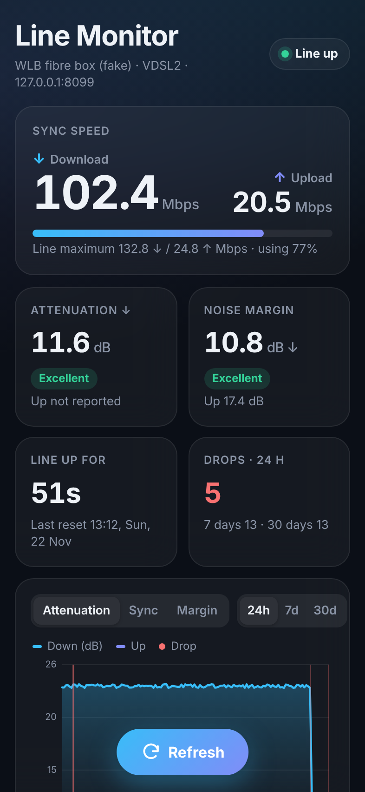
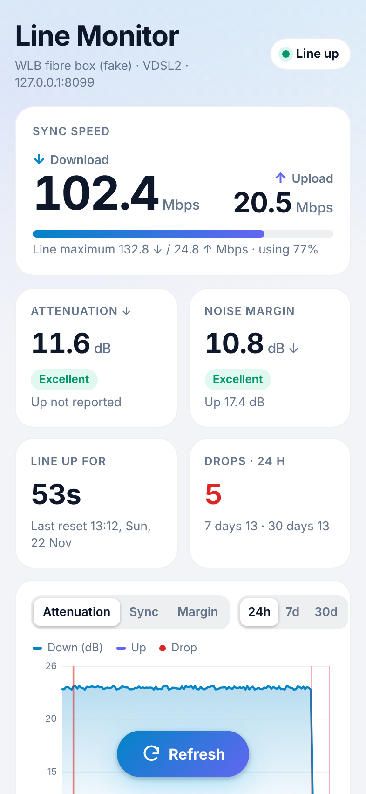

# Pure Line Monitor

A small web app for the Pure Telecom Sagemcom "WLB fibre box" (VDSL2 on Open eir). It reads the line from the modem, keeps a history, and shows it on an iPhone-friendly page with a **Refresh** button:

- **Sync speed** down/up, and the line maximum
- **Downstream attenuation**, with a quality rating
- **Noise margin** down/up
- **Line resets**: when the line last re-synced, and every drop with its date and time, how long it was offline, and where it came from (the router log or the monitor)
- Charts of attenuation, sync speed and noise margin over 24 hours, 7 days or 30 days, with drops marked

| Dark | Light |
| --- | --- |
|  |  |

*(Screenshots use demo data from the fake router in `tests/`.)*

## Two ways to run it

| | **NAS (Docker)** | **iPhone only (Scriptable)** |
| --- | --- | --- |
| Needs | An always-on NAS or PC at home | Just the iPhone and the free Scriptable app |
| Readings | Every 5 minutes, 24/7 | When you open the app, and when iOS refreshes the widget (roughly every 15–30 minutes) |
| Drop history | Complete | Gaps while the phone is away or idle |
| Home-screen widget | – | Yes |

Both show the same dashboard. The iPhone-only version is a backup for when the NAS is down. They can run at the same time.

## iPhone only (Scriptable)

The app runs inside [Scriptable](https://apps.apple.com/app/scriptable/id1405459188), a free app that runs JavaScript on iOS. Safari can't do this, because it won't let a web page talk to the Pure box; Scriptable can. The box's password is stored in the iPhone **Keychain** and only ever sent to the box, hashed.

**Install (once):**
1. Install **Scriptable** from the App Store and open it.
2. Tap **+** (top right), then tap the title and name the script `Install Line Monitor`.
3. Paste in the contents of [`scriptable/Install Line Monitor.js`](scriptable/Install%20Line%20Monitor.js). On GitHub, open the file and tap the **copy** button.
4. Tap **▶︎** (bottom right). A new script, **Line Monitor**, appears in the list. Run the installer again any time to update.

**First run (on home Wi-Fi):**
1. Tap **Line Monitor**. Enter the Pure box address (`192.168.1.254`), username (`admin`) and password.
2. When iOS asks **"Scriptable would like to find and connect to devices on your local network"**, tap **Allow**. Without it, the app can't reach the box. To change it later: Settings → Privacy & Security → Local Network → Scriptable.
3. The dashboard opens. Tap **Refresh** to read again. **Settings** at the bottom changes the login or clears the history.

**Home-screen widget:** long-press the home screen → **+** → **Scriptable** → pick the small or medium size → **Add Widget**. Then long-press the widget → **Edit Widget** → Script: **Line Monitor**. It shows download sync, attenuation and drops in the last 24 hours. Tapping it opens the full dashboard. Lock-screen widgets work too.

**App icon (optional):** in the **Shortcuts** app, make a shortcut with Scriptable's **Run Script** action (script: Line Monitor). Then use **Share → Add to Home Screen**.

**How it treats the box:** each read is one login, one or two queries and a logout, so no sessions are left open. It reads at most once a minute, and after any error it leaves the box alone for 10, then 20, then 30 minutes. It does not download the router log.

It only works on home Wi-Fi, or over a VPN that can reach 192.168.1.254. Away from home it shows the last reading and says it can't reach the box.

The script is built from `scriptable/src/` plus the shared dashboard in `app/static/` (`python scriptable/build.py`). Edit those files, not the generated `scriptable/Line Monitor.js`.

## How it works

```
iPhone (Safari / home-screen app)
        │  http://<nas>:8088
        ▼
Line Monitor (Docker on the NAS) ── reads every 5 min + on Refresh ──▶ Pure box 192.168.1.254
        │                                                              (/cgi/json-req, same API as its web page)
        └─ SQLite history in ./data
```

The app logs in to the Pure box the same way its own web page at `/2.0/gui/` does, keeps that **one** session open and reuses it, and reads `Device/DSL` (TR-181 line stats). It logs out when it stops.

**Be gentle with the box.** The Pure box's web interface is fragile. Repeated logins, or downloading its log file, can make it return HTTP 500 and show "Communication error with the gateway" on its own admin page for a while. So the app reads every 5 minutes, limits Refresh to one real read a minute, backs off (up to 30 minutes) after any error, and leaves the router-log download off. Drops are detected from the line's sync time instead. The box's password stays in `.env` on the NAS. It is never sent to the phone or stored in this repo.

**Why it isn't a GitHub Pages site.** A page served from GitHub is HTTPS, and Safari won't let it call a plain-HTTP device on your network. The Pure box also doesn't allow cross-site requests, and the router password would have to sit in the phone's browser. So GitHub holds the code, and a small server on your own network does the reading.

If the Pure box sits behind your own router (double NAT), devices on your home network can usually still reach 192.168.1.254 through it, so the NAS can run this.

## Set up on the NAS

You need Docker: Container Station on QNAP, or Docker on UGREEN.

1. **Connect** from PowerShell (Windows) or Terminal (Mac): `ssh <your-admin-user>@<NAS-IP>`. On QNAP, turn SSH on first under Control Panel → Network & File Services → Telnet / SSH. If a menu appears, press **Q**, then **Y**.
2. **Get the code.** QNAP has no `git`, so download the archive instead. Paste **one line at a time**:
   ```sh
   cd /share/Container
   wget https://github.com/YabbaYabbaYabba/pure-line-monitor/archive/refs/heads/main.tar.gz
   tar xzf main.tar.gz && mv pure-line-monitor-main pure-line-monitor && cd pure-line-monitor
   cp .env.example .env
   ```
3. **Add the Pure box password.** Run `vi .env` and move to the `ROUTER_PASSWORD=` line. Press **Shift+A**, type the password, press **Esc**, then type `:wq` and press Enter. Then lock the file:
   ```sh
   chmod 600 .env
   grep -c '^ROUTER_PASSWORD=.' .env     # prints 1 when the password is set
   ```
   Keep `.env` to plain `NAME=value` lines; some Docker versions reject comments in it. The settings are explained in the table below.
4. **Check the NAS can reach the box:** `curl -sI http://192.168.1.254/ | head -1` should print an HTTP status line.
5. **Start it.** On QNAP, Docker needs admin rights, so use `sudo` (it asks for your NAS password):
   ```sh
   sudo docker compose up -d --build
   sudo docker compose logs --tail 20      # look for "Router login method detected: ..."
   ```
   If `docker compose` isn't recognised, older Container Station versions use `docker-compose` instead.
6. Open `http://<NAS-IP>:8088` from a device on the home network.

To update later, download the archive again into a new folder, copy your `.env` across, and run `sudo docker compose up -d --build`. The history lives in a Docker volume (`line-data`), so it is kept.

### Without Docker

Any always-on machine with Python 3.11+ on the home network can run it:

```sh
pip install -r requirements.txt
cp .env.example .env   # fill in the password
python -m app.server   # http://<machine>:8080
```

## Put it on your iPhone

1. On the iPhone, connected to home Wi-Fi (or over a VPN), open **Safari** and go to `http://<NAS-IP>:8088`.
2. Tap **Share** → **Add to Home Screen** → **Add**.

It opens full-screen like an app, with its own icon. Tap **Refresh** to read the box straight away. The page also updates itself every minute while open, and the server keeps reading every 5 minutes even when the phone is closed, so the history has no gaps.

## First run: check the readings

Open `http://<NAS-IP>:8088` and compare the figures with the Pure box's own status page. If one is 10× off (for example, attenuation shows 2.4 instead of 23.7), set `DB_SCALE=db` (or `tenths`) in `.env` and restart.

For troubleshooting only, `DEBUG_ENDPOINTS=1` turns on `/api/debug/parse` and `/api/debug/xpath?x=Device/DSL`. They share the app's single session, but turn them off again afterwards.

## How drops are detected

On each reading, the app works out when the line last synced (now minus showtime). If that time has moved forward since the last reading, the line re-synced, and the app records a drop with the resync time. If the line is down at the moment of a reading, that is recorded too.

With readings 5 minutes apart, several drops in one burst show as one resync. The 7-day sync-time history is still clear evidence of an unstable line.

The router log ("VDSL connectivity is down", with exact times) can be read too: set `ROUTER_LOG=1`. On the Fast5366SD (Pure "WLB fibre box") the log download made the box's web interface fail, so it is **off by default**.

## Settings (`.env`)

| Setting | Default | Meaning |
| --- | --- | --- |
| `ROUTER_HOST` | `192.168.1.254` | Pure box address |
| `ROUTER_USER` / `ROUTER_PASSWORD` | `admin` / – | Box admin login |
| `ROUTER_AUTH_METHOD` | `auto` | `MD5`, `SHA512` or `MD5_NONCE`. Your box uses `MD5`; setting it skips detection. |
| `POLL_SECONDS` | `300` | Seconds between readings (minimum 60) |
| `ROUTER_LOG` | `0` | `1` = also download the router log (see above; can upset the box) |
| `APP_PASSWORD` | – | If set, the page asks for this password (HTTP basic auth, any username) |
| `DB_SCALE` | `auto` | `auto`, `tenths` (box reports 237 for 23.7 dB) or `db` |
| `KEEP_DAYS` | `90` | How long history is kept |
| `DEBUG_ENDPOINTS` | `0` | `1` turns on the `/api/debug/*` pages |

## Security notes

- The app only **reads** from the box: it gets values, downloads the log and logs out. It never changes settings.
- Credentials live only in `.env` on the NAS (git-ignored, `chmod 600`). The browser never sees them.
- The container runs as a non-root user (uid 10001).
- The page is served over plain HTTP on your home network. Don't port-forward it. For access away from home, use a VPN.
- Responses carry a strict Content-Security-Policy (no third-party scripts, fonts or trackers) and `no-store` on API calls.
- On first start, `auto` tries the hash methods one at a time and keeps the first session that logs in, so no extra sessions are left open. The method found is remembered. Setting `ROUTER_AUTH_METHOD` skips detection entirely.

## Troubleshooting

| You see | Do this |
| --- | --- |
| "Login to the Pure box failed" | Check the password by logging in at http://192.168.1.254/2.0/gui/ |
| "Returned an error (HTTP 500)", or the box's own page says "Communication error with the gateway" | The box's web interface is overloaded. Stop the app (`sudo docker compose stop`), wait 10–15 minutes, and check that `ROUTER_LOG=0`. Internet access isn't affected. |
| "Too many open sessions" | Log out of the box's web page in other browsers |
| "Can't reach the Pure box" | Run the reachability check from the NAS (setup step 4) |
| Figures look 10× off | Set `DB_SCALE` (see First run) |

## Try it without the router

```sh
python tests/fake_router.py &                                   # fake box on 127.0.0.1:8099
ROUTER_HOST=127.0.0.1:8099 ROUTER_PASSWORD=x python -m app.server
python tests/test_parsing.py                                    # parsing checks
FAKE_PASSWORD=pw python tests/fake_router.py &                   # strict fake box: checks login hashes
node tests/scriptable_harness.js scenario.json                  # runs the iPhone script with stand-in iPhone APIs
```
